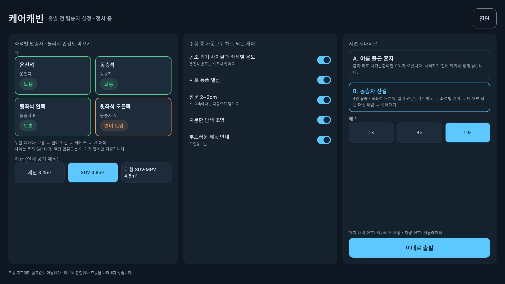
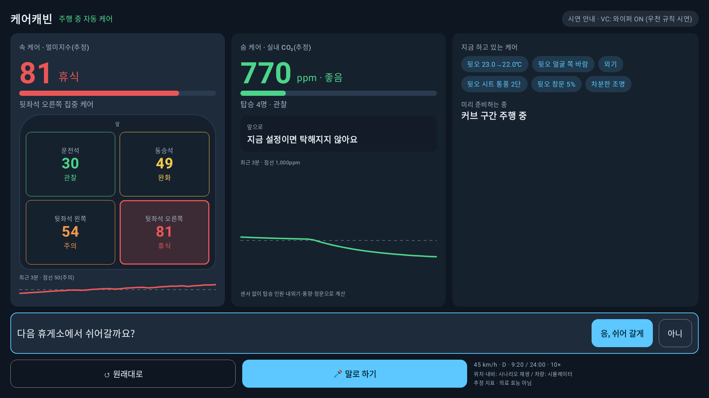
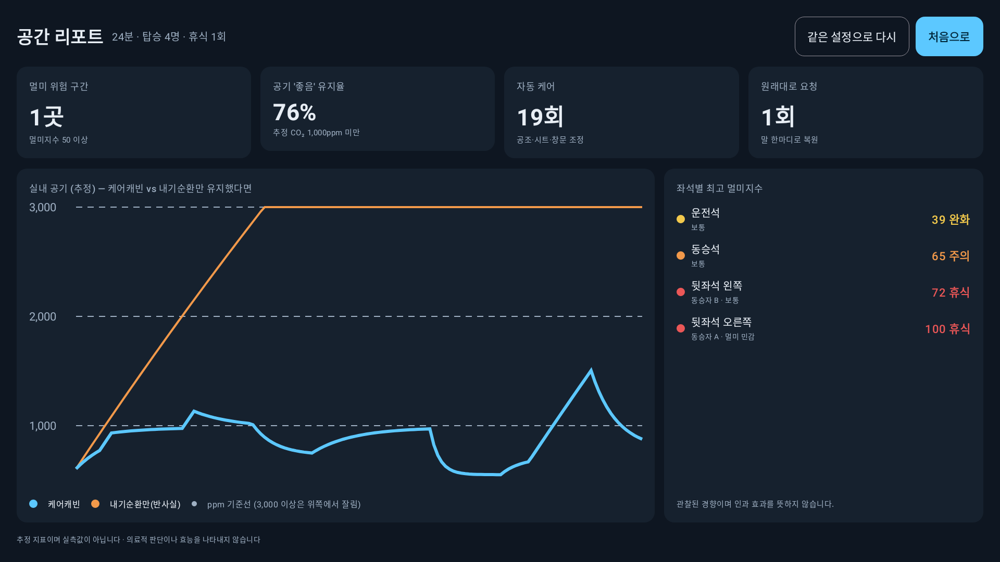
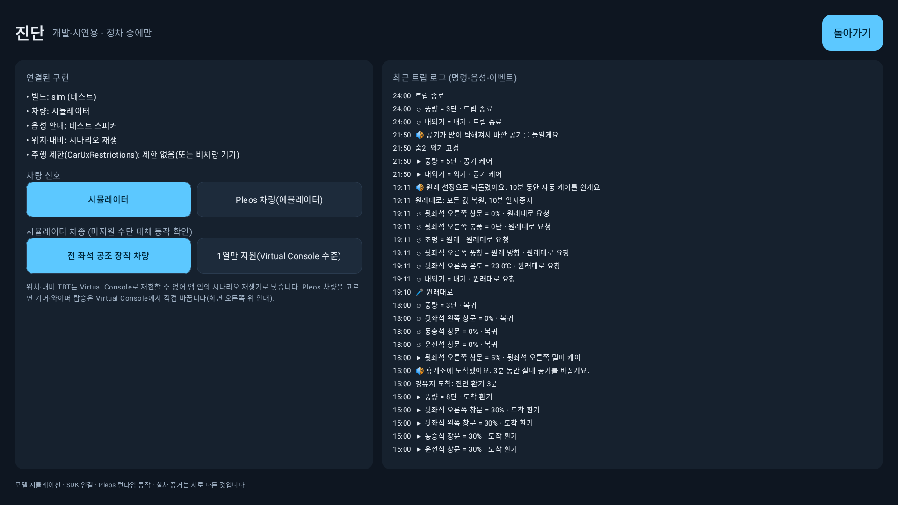

# 케어캐빈 (CareCabin)

**멀미도, 탁한 공기도 — 오기 전에 차가 먼저 살핍니다.**
현대자동차그룹 차량용 앱 개발 공모전(Code your App into Pleos App Market) 출품작 · Pleos Connect 차량용 앱. 차량 데이터로 좌석별 멀미지수와 실내 CO₂를 추정하고, 나빠지기 전에 공조·시트·창문·음성으로 좌석마다 따로 케어합니다.

> 화면의 멀미지수와 CO₂는 **추정 지표**입니다. 실측값이 아니며 의료적 판단이나 효능을 나타내지 않습니다.

## 핵심 기능 (MVP 0.2.0)

| 기능 | 내용 | 코드 |
|---|---|---|
| 좌석별 멀미지수 | 위치(진행방향·좌표) → 속도·요레이트 → 횡가속, 10분 감쇠 노출량 + 내비 TBT 3km 예측, 좌석 위치·개인 민감도 반영 | `engine/.../motion/MotionEngine.kt` |
| 가상 CO₂ 센서 | 질량수지 `dC/dt = N·G/V − λ(C − C_out)`, 탑승 인원(좌석 감지)·내외기·풍량·창문으로 환기율 계산 | `engine/.../air/AirModel.kt` |
| 케어 오케스트레이터 | 케어 사다리(관찰·완화·주의·휴식 / 환기 사이클·외기 고정), 히스테리시스, 우선순위(운전 안전 → 멀미 위험 좌석 → 공기 → 쾌적), 하드 규칙(운전석 온도·시트 불변, 우천·고속 창문 금지), "원래대로" 원복 | `engine/.../care/CareOrchestrator.kt` |
| 스마트 환기 사이클 | 1,000ppm 도달 120초 전 예측 → 외기 60~180초 삽입 | 〃 |
| 음성 케어 | 커브 예고·조치 안내·쉬어가기 질문(TTS), "멀미 나 / 답답해 / 원래대로 / 응 / 아니"(STT 키워드) | `IntentParser`, `platform/` |
| 쉬어가기 | 휴식 제안 → "응" → NaviHelper `addWaypoint` → 도착 시 3분 전면 환기 | 〃 |
| 차종 대응 | 지원 안 되는 수단은 다음 수단으로 자동 대체 (예: 뒷좌석 존 없음 → 비어 있는 동승석 존·풍향 → 풍량) | 〃 |
| 화면 | 출발 전 설정(정차) · 주행 중(카드 3개 + 버튼 2개) · 공간 리포트 · 진단 | `app/.../ui/` |

## 사용한 Pleos Connect SDK

| SDK | 버전 | 쓰는 곳 |
|---|---|---|
| Vehicle | 2.3.2 | 탑승 감지, 내외기·풍량·존 온도·풍향, 시트 통풍, 창문, 와이퍼, 기어, 조향각, 브레이크 (읽기·제어) |
| NaviHelper | 3.0.5 | `onTBTInfo`(앞길 커브 예측), `addWaypoint`(휴게소 경유), `onWayPointArrived`·`onDestinationArrived` |
| FusedLocation | 1.1.3 | `registerFusedLocationCallback` (진행방향·좌표 → 요레이트·속도) |
| TextToSpeech | 3.3.1 | 커브 예고·안내 음성 (온디바이스) |
| SpeechToText | 3.3.1 | 키워드 인식 (온디바이스, [말로 하기] 버튼을 누를 때만) |

퍼미션은 `app/src/pleos/AndroidManifest.xml`에 선언합니다. 개발 단계에서는 퍼미션 선언만으로 SDK를 호출할 수 있고, Pleos 앱마켓 배포 때는 승인된 퍼미션만 남깁니다.

## 실행 방법

### APK
저장소의 `apk/` 폴더에 있습니다(debug 키 서명, 버전 0.2.0-mvp).

- `apk/CareCabin_pleos_release.apk` — **Pleos Connect Emulator용(공모전 빌드).** SDK 5종 포함. Pleos 서비스가 없는 기기에서는 부분별로 시뮬레이터·Android TTS로 대체합니다.
- `apk/CareCabin_sim_release.apk` — SDK 없는 빌드. 일반 Android 기기·에뮬레이터에서 화면과 시나리오를 볼 수 있습니다.

```bash
adb install -r apk/CareCabin_pleos_release.apk
```

### 시연 (약 2~3분, 10배속)
1. 앱 실행 → **출발 전 설정** 화면에서 시나리오 선택
   - **A. 여름 출근 혼자**: 혼자 타도 내기순환이면 CO₂가 오릅니다. 1,000ppm 전에 외기를 짧게 넣고 다시 내기로 돌아옵니다.
   - **B. 동승자 산길**: 4명 탑승, 뒷좌석 오른쪽 '멀미 민감'. 커브 예고 → 좌석별 케어 → 와이퍼 ON 시 창문 대신 바람 → 쉬어가기 제안([응]) → 휴게소 환기 → [원래대로]
2. 좌석 카드를 누르면 민감도(보통 → 멀미 민감 → 케어 끔 → 빈 좌석)가 바뀝니다. 차급·허용 케어 토글도 바꿀 수 있습니다.
3. 배속(1×/4×/10×)을 고르고 **[이대로 출발]**
4. 주행 화면 오른쪽 위에 "지금 Virtual Console에서 할 일"이 뜹니다(Pleos 차량 모드일 때 따라 하면 됩니다).
5. 끝나면 **공간 리포트**(공기 '좋음' 유지율, 케어캐빈 vs 내기순환만 유지했을 때 CO₂ 곡선, 좌석별 최고 멀미지수)

### 하이브리드 시연 구조 (중요)
- **위치·내비 TBT**는 Virtual Console로 재현할 수 없어서 **앱 안의 시나리오 재생기**로 넣습니다(합성 트랙, 실제 지도 데이터 아님).
- **차량 신호**는 진단 화면에서 고릅니다.
  - `시뮬레이터`: 앱 안의 가상 차량이 명령을 즉시 반영합니다. 시나리오의 기어·와이퍼·탑승 변경도 자동으로 들어갑니다.
  - `Pleos 차량(에뮬레이터)`: Vehicle SDK로 실제 set/register를 호출합니다. 기어·와이퍼·탑승은 Virtual Console에서 사람이 바꿉니다.
- 진단 화면의 `1열만 지원(Virtual Console 수준)`을 고르면 뒷좌석 존이 없는 차의 대체 동작을 볼 수 있습니다.

## 테스트 환경
- Android Studio, JDK 17, Gradle 8.11.1, AGP 8.10.1, Kotlin 2.2.21
- `minSdk 28`, `compileSdk/targetSdk 34`
- Pleos Connect Emulator(API 34) + Virtual Console — 설치는 Pleos Playground 개발 문서를 따릅니다.
- 화면 기준 1920×1080 가로

## 빌드

```bash
./gradlew :engine:test                  # 엔진 단위·시나리오 테스트 (JUnit 5)
./gradlew :app:testSimDebugUnitTest     # 화면 렌더링 → app/build/screens/
./gradlew :app:assemblePleosRelease     # 공모전 빌드 (Pleos SDK 5종)
./gradlew :app:assembleSimRelease       # SDK 없는 빌드
```

- release 서명: 루트에 `keystore.properties`(git 제외: `storeFile`, `storePassword`, `keyAlias`, `keyPassword`)가 있으면 그 키로, 없으면 debug 키로 서명합니다.
- Pleos SDK는 `https://nexus-playground.pleos.ai/repository/maven-releases/`에서 받습니다.
- Windows 사용자 경로에 비ASCII 문자가 있어 Gradle worker나 AAPT2가 실패하면, 프로젝트를 빈 드라이브에 `subst`하고 ASCII 경로의 `GRADLE_USER_HOME`을 쓰세요.

## UX 원칙 (주행 중)
- 주행 화면은 카드 3개 + 버튼 2개([원래대로] [말로 하기])만. 설정·프로필·리포트로 가는 길 없음. `CarUxRestrictions`가 제한을 걸면 설정 화면은 잠기고 진행 중인 트립은 주행 화면으로 돌아갑니다.
- 색만으로 상태를 전하지 않습니다: 모든 색 표시에 단계 글자(관찰·완화·주의·휴식 / 좋음·보통·나쁨)를 붙입니다. 화면 낭독기용 설명과 실시간 알림(질문·음성 자막)을 넣었습니다.
- 터치 영역 최소 76dp, 애니메이션 없음, 숫자는 크게. 음성 자막은 20초 뒤 사라집니다.
- 숨 케어 카드에 "앞으로" 예측(예: 약 3분 뒤 탁해질 예정 · 그 전에 환기 / 바깥 공기 넣는 중 1:20 남음)과 최근 3분 추세를 보여 줍니다.
- 정차 중에만 [시연 종료]가 보이고, 누르면 트립이 바꾼 값을 모두 되돌립니다. 설정은 기기에 저장돼 다음 실행 때 유지됩니다.

## 화면

| 출발 전 설정 | 주행 중 · 좌석별 케어 |
|---|---|
|  |  |
| **공간 리포트** | **진단** |
|  |  |

## 구조

```
engine/   순수 Kotlin (Android·SDK 의존 없음) — 단위 테스트가 몇 초 만에 돕니다
  model/    좌석·탑승자·차량 신호·조작 수단(Actuator)·음성 의도
  motion/   멀미지수 (Geo, MotionEngine)
  air/      가상 CO₂ (AirModel, λ 테이블)
  care/     케어 오케스트레이터
  session/  트립 1회 파이프라인 + 리포트 (CareSession)
  sim/      시나리오·합성 트랙·시뮬레이터 차량·시나리오 실행기
app/
  src/main/   Compose UI, CareController, 플랫폼 인터페이스
  src/sim/    SDK 없는 플랫폼
  src/pleos/  Pleos SDK 어댑터 (Vehicle·NaviHelper·FusedLocation·TTS·STT)
```

## 검증 범위와 한계
- `:engine:test` 34개: 해석해 대비 적분 오차, 환기 정상상태, 임계 예측, 멀미지수 기준 사례(직선·원·사인 커브·GPS 튐·조향 대체·커브 예고), 오케스트레이터 규칙(운전석 불변, 우천·고속 창문 금지, 공용 외기 1회, 히스테리시스, 원복과 10분 일시중지, 일시중지 중 공기 안전 예외, 권한 토글, 1열 대체), 시나리오 A·B 끝까지 재생, 중간 종료 시 전부 복원.
- `:app:testSimDebugUnitTest` 1개: 실제 컨트롤러로 시나리오 B를 돌리며 화면 4종을 1920×1080으로 렌더링(Robolectric 네이티브 그래픽) → `docs/screens/*.png`.
- 합성 데이터에서 통과해도 **센서 정확도나 멀미 완화 효능의 증거는 아닙니다.** 상수는 문헌 범위를 참고한 초기 추정값이고, 시나리오로 맞췄습니다.
- Pleos 어댑터는 SDK 5종의 실제 클래스·메서드 시그니처로 컴파일됩니다. **Pleos Connect Emulator에서 각 set 호출이 실제로 반영되는지는 아직 확인 전**입니다(창문 값 단위, 존 지원 범위 포함).
- 앰비언트 조명은 MVP에서 Pleos 연결을 하지 않았습니다(시뮬레이터에서만 표시).
- 주행 중 화면 제한(CarUxRestrictions)은 AAOS에서만 구독합니다(`UxGate`). Pleos Connect Emulator에서 Gear D만으로 제한이 걸리는지는 아직 확인 전입니다.
- 실제 주행(시나리오 없이 Pleos 위치·TBT로 도는 모드)은 MVP에 넣지 않았습니다. 어댑터(`PleosLocation`, `PleosNavi`)는 준비돼 있습니다.

## 개발 도구와 권리
- 기획·개발 과정에서 생성형 AI 보조 도구를 활용했습니다(공모전 설명회 기준 허용). 구조와 로직은 출품자가 직접 설명합니다.
- 공모전 심사를 위해 공개한 저장소입니다. 별도 라이선스를 부여하지 않으며 모든 권리는 출품자에게 있습니다.
